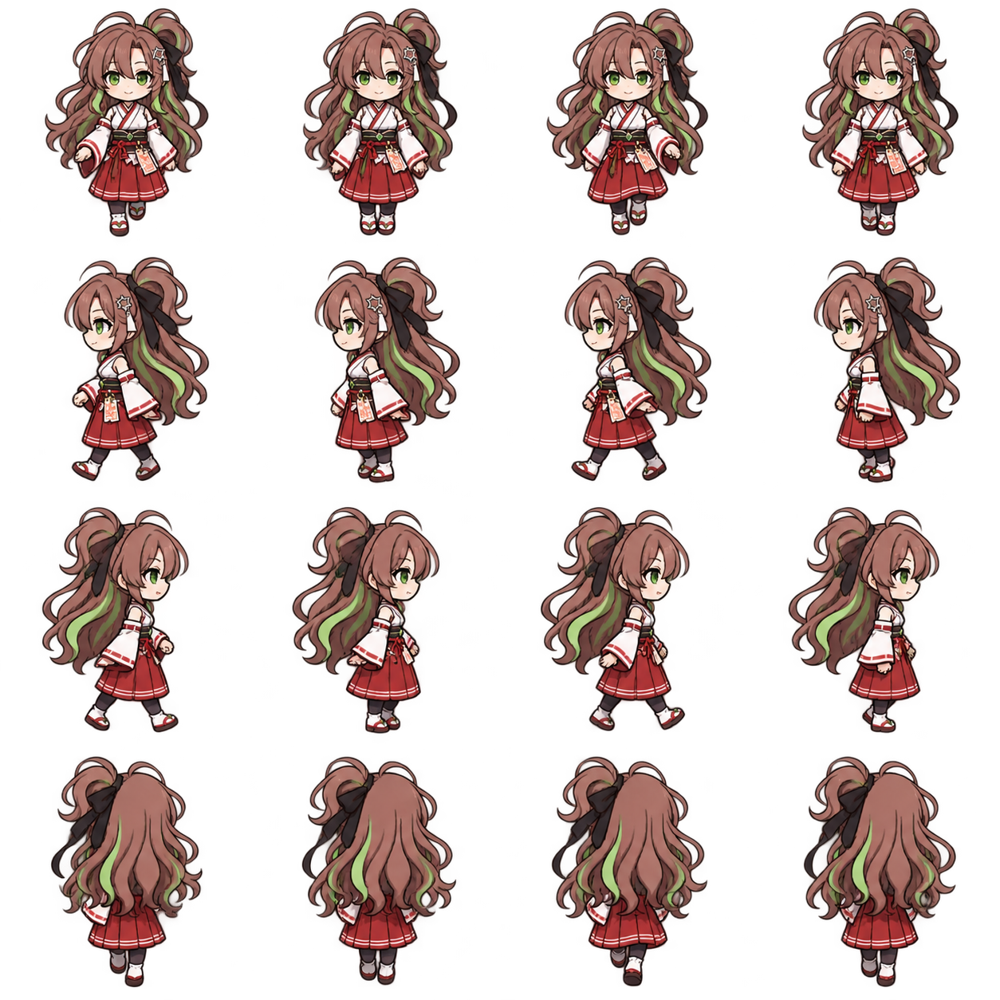
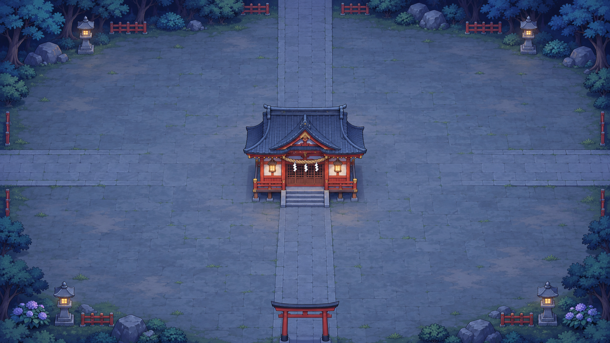
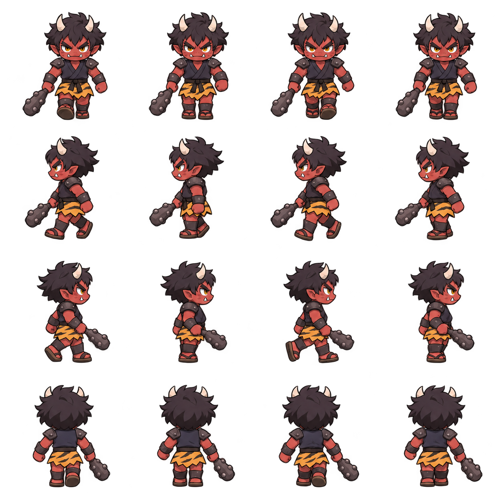
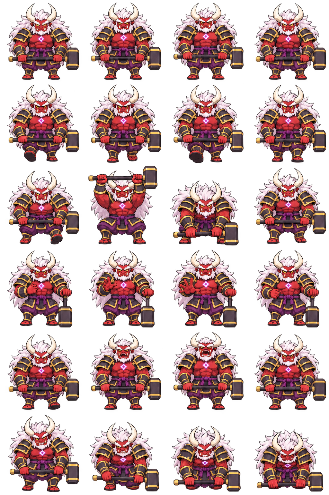

# 檢查清單

每一步做完，照這張清單看一遍吧。打勾的是「應該要有」的；和你的不一樣也別緊張，看每一步最後的「如果和你的不一樣」就好。
圖是我們那次做出來的樣子，AI 每次畫的都不一樣，長得像就可以啦～

## 第 1 步：規劃

- [ ] 失敗條件：神社被打幾次就輸？
- [ ] 有幾波敵人：一共打幾波？
- [ ] 如何升級：升級時能選什麼？

**如果和你的不一樣**

- 規劃少了什麼，直接問它，或叫它修改。
- 我們遇到的小意外：AI 不寫規劃，直接開始寫程式 → 跟它說「先停下來，先給我看規劃。」

**這是你的世界**：換成你的題材前，先想想這三個問題，再改你的遊戲企畫。

- 主角要做什麼？　我們：巫女守神社　例如：貓咪守冰箱：趕走偷吃的老鼠
- 玩家要克服什麼困難？　我們：妖怪一波一波來　例如：吃到零食會變胖
- 怎麼樣算輸？　我們：神社被打十次　例如：冰箱被搬空

## 第 2 步：主角

我們的成品：

**主角立繪**

- [ ] 髮型髮色：跟你的角色一樣嗎？
- [ ] 全身入鏡：頭到腳都有嗎？
- [ ] 白色背景：乾淨的白底

**主角圖集**

- [ ] 四排方向：由上到下：朝下、朝左、朝右、朝上
- [ ] 十六格同一人：每一格都是同一個造型
- [ ] 透明背景：沒去掉就跟它說「請把背景改成透明」

**如果和你的不一樣**

- 背景沒去掉 → 跟它說「請把背景改成透明」。
- 一直畫歪，或免費版額度用完 → 下載 [存檔點/步驟2-巫女圖集.png](%E5%AD%98%E6%AA%94%E9%BB%9E/%E6%AD%A5%E9%A9%9F2-%E5%B7%AB%E5%A5%B3%E5%9C%96%E9%9B%86.png) 拖進同一個對話串，貼：「這是主角的 spritesheet，四乘四，由上到下是朝下、朝左、朝右、朝上。之後請用這張。」

## 第 3 步：背景

我們的成品：

AI 自己列了製作重點，拿來對答案：

- [ ] 視角：略帶俯角的固定視角，角色走到哪裡大小都一樣
- [ ] 四個方向：神社在中央，上下左右都有路
- [ ] 地面：低對比、少花紋，不然角色和經驗球會糊在一起
- [ ] 比例：16:9，跟遊戲畫面一樣寬

**如果和你的不一樣**

- 你在第 1 步改了題材，這一步的提示詞不用改，ChatGPT 會照你的企畫畫。

## 第 4 步：敵人

我們的成品：

- [ ] 強弱一眼看得出來：不看血條也知道哪隻比較強
- [ ] 顏色分得開：不要跟綠色的經驗球混在一起
- [ ] 四個方向都有：敵人會從四邊進來
- [ ] 放大看邊緣：有沒有雜色、藍邊

**如果和你的不一樣**

- 我們遇到的小意外：AI 說「已清理」，放大四倍還有一圈藍邊 → 跟它說「請再清一次背景，或自己用繪圖軟體修乾淨」

**這是你的世界**：敵人可以換成「狸貓、河童」。「比剛剛的稍微強一點」這句留著。

## 第 5 步：BOSS 和招式

我們的成品：

- [ ] 只有正面：不會轉身，不用背面
- [ ] 每招都有預警：紅圈、聚氣、仰頭吸氣
- [ ] 體型夠大：比小怪大好幾倍
- [ ] 背景是透明的：灰底就再去背一次

**如果和你的不一樣**

- 我們遇到的小意外：第一版的鬼王帶著灰色背景 → 跟它說「請再去背一次」

**這是你的世界**：想加招式，在提示詞後面加一句「其中一招要會分身」。

## 第 6 步：第一版

- [ ] 能開始：按「開始守護」進得去
- [ ] 能移動：WASD／方向鍵
- [ ] 會升級：升級時三選一
- [ ] 鬼王會出來：第 4 分鐘左右登場
- [ ] 會輸也會贏：神社失守／神社守護成功

**如果和你的不一樣**

- AI 說它的測試瀏覽器進不去，沒看過畫面 → 正常，打開預覽自己玩一遍就是驗收。

## 第 7 步：修問題

- [ ] 聲音：開始畫面、一般戰鬥、鬼王戰會換曲
- [ ] 音量：音樂和音效可以分開調
- [ ] 靜音：有靜音開關
- [ ] UI：血條、結界、經驗不擋臉、看得清楚
- [ ] 你自己的問題：玩一次，找出你不喜歡的地方

**如果和你的不一樣**

- 打開遊戲沒聲音 → 按右上角「開啟聲音」（瀏覽器規定要先點一下才能出聲）。
- 我們遇到的小意外：修好了血條，戰場被擠小，左右出現黑邊 → 跟它說「請把剛剛的修改還原。（然後拆開，一次改一條）」
